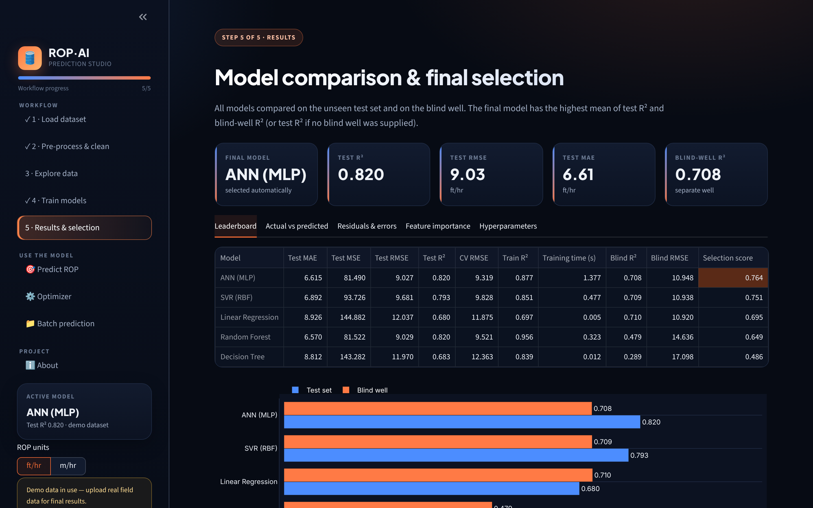
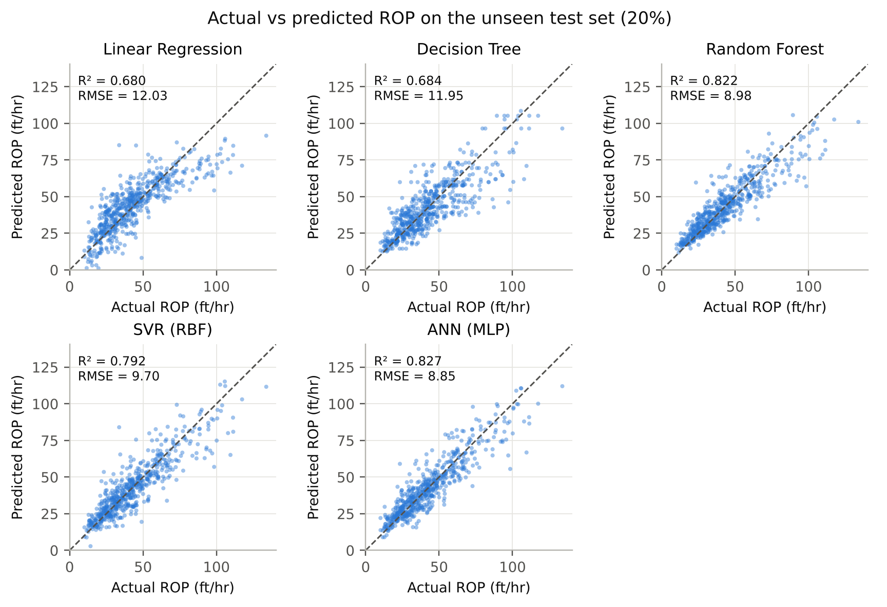
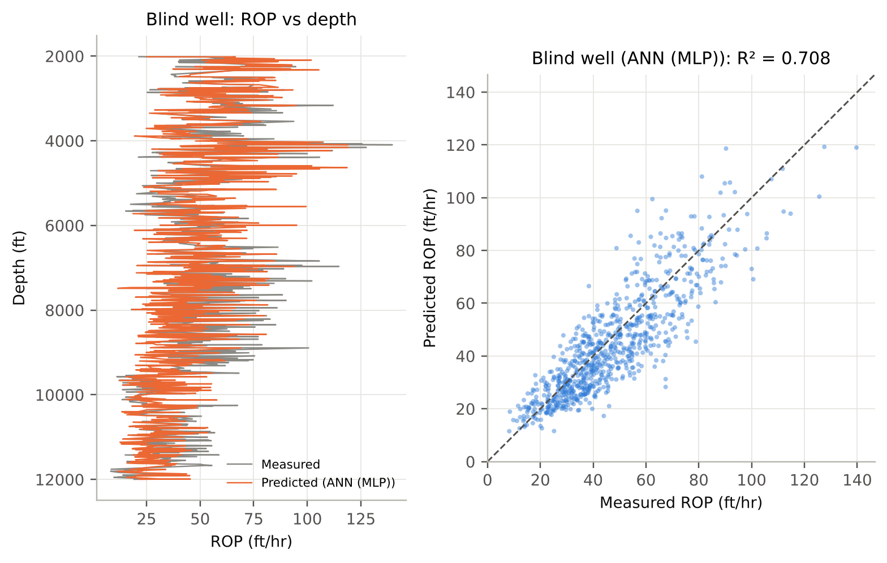
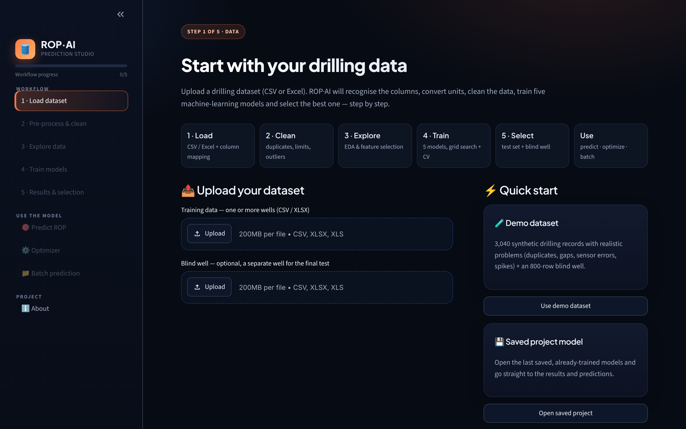
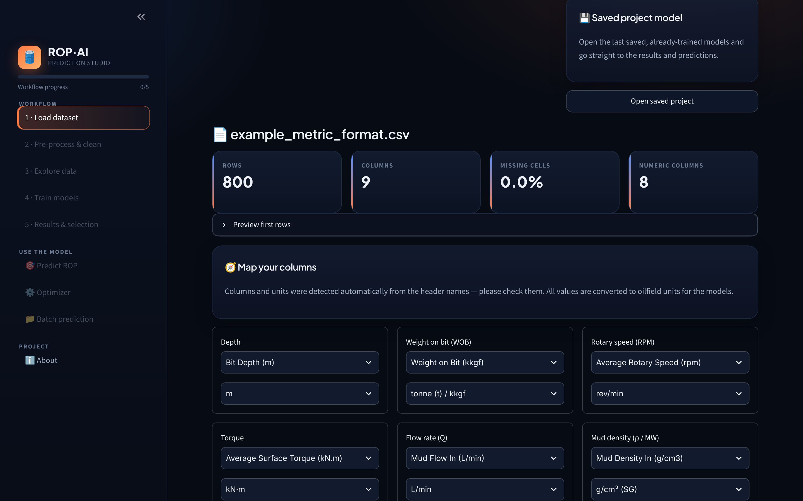
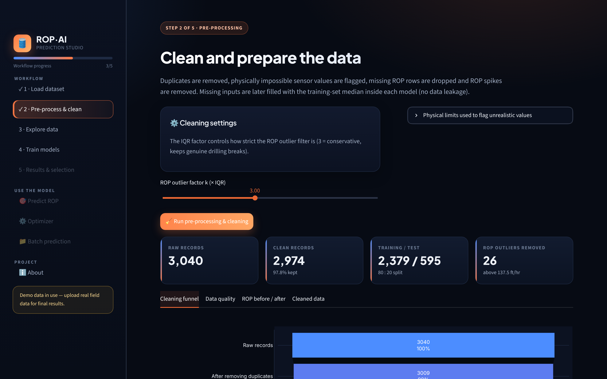
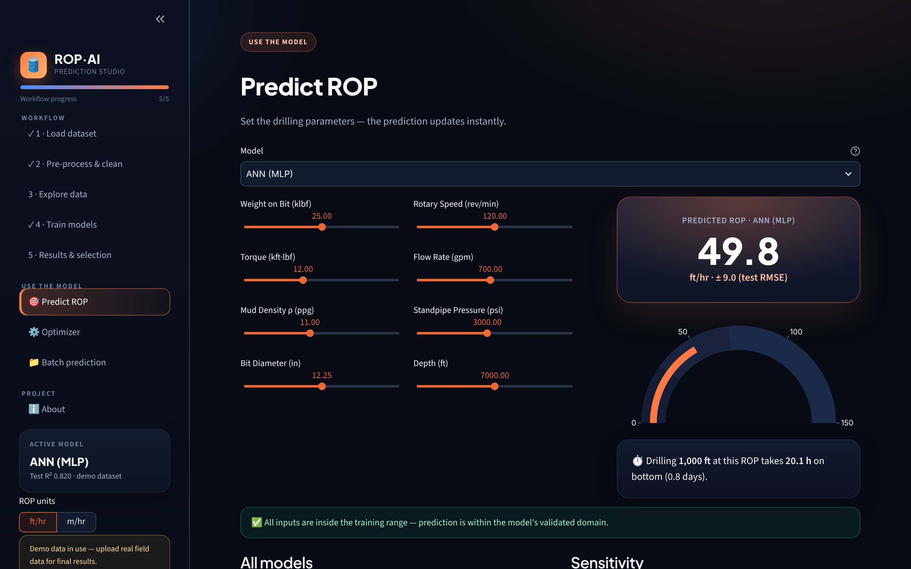
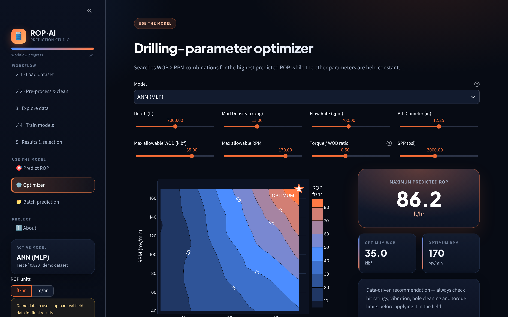

<div align="center">

# 🛢️ Prediction of Rate of Penetration (ROP) Using Machine Learning

**BS Final Year Project · Department of Petroleum & Gas Engineering · BUITEMS, Quetta**


*Predicting how fast the drill bit penetrates the rock from eight everyday surface drilling parameters —
with five machine-learning models, a blind-well test and an interactive web app.*



</div>

---

## 📌 About the project

Rate of Penetration (ROP) controls drilling time and therefore a large share of well cost. Classical ROP
equations (Bingham, Bourgoyne–Young) need field-specific coefficients and cannot capture the nonlinear
interaction between drilling parameters. This project builds a **complete, reproducible machine-learning
workflow** that predicts ROP from commonly available drilling data, following the supervisor's methodology:

```
Data Collection → Cleaning → EDA → Feature Selection → Pre-processing (80:20, standardization)
→ 5 Models → Grid Search + 5-fold CV → Testing (MAE, MSE, RMSE, R²) → Blind-well test → Final ROP model
```

| Inputs (X) | Output (Y) |
|---|---|
| WOB (klbf) · RPM · Torque (kft·lbf) · Flow rate Q (gpm) · Mud density ρ (ppg) · SPP (psi) · Bit diameter D (in) · Depth (ft) | ROP (ft/hr) |

**Models:** Linear Regression (baseline) · Decision Tree · Random Forest · Support Vector Regression (RBF) · Artificial Neural Network (MLP)

## 📊 Results (demonstration data)

> ⚠️ **The numbers below come from a physics-based *synthetic* demonstration dataset**, used to build and
> verify the workflow before real field data were available. Run the pipeline on real drilling data
> (e.g. the Equinor Volve dataset) to obtain the final project results — every table, figure and document
> regenerates automatically.

| Model | Test R² | Test RMSE (ft/hr) | Blind-well R² | Selection score |
|---|---:|---:|---:|---:|
| **ANN (MLP)** ⭐ final | **0.820** | **9.03** | **0.708** | **0.764** |
| SVR (RBF) | 0.793 | 9.68 | 0.709 | 0.751 |
| Linear Regression | 0.680 | 12.04 | 0.710 | 0.695 |
| Random Forest | 0.822 | 8.99 | 0.476 | 0.649 |
| Decision Tree | 0.683 | 11.97 | 0.289 | 0.486 |

**Key finding:** Random Forest is best on the random test split but loses most of its accuracy on a
completely new well, because tree models memorise field-specific depth patterns. The ANN generalises best
and is selected as the final model (score = mean of test R² and blind-well R²).

<p align="center">
  
  
</p>

## 🌐 ROP·AI web application — guided workflow

A premium dark-themed Streamlit studio. **When it opens it asks for your drilling data**, then guides you step by step:

| Step | What happens |
|---|---|
| **1 · Load dataset** | Upload CSV/Excel (+ optional blind well). Columns **and units** are recognised automatically (e.g. `Weight on Bit (kkgf)`, `Rate of Penetration (m/h)`) and converted to oilfield units. Or use the demo dataset / open the saved project. |
| **2 · Pre-process & clean** | Duplicates, physical-limit checks, missing ROP, k×IQR outliers, 80 : 20 split — cleaning funnel, data-quality chart, before/after plots |
| **3 · Explore data** | ROP vs parameters, distributions, correlation heatmap, depth log, feature selection (Pearson, MI, RF importance, RFECV) |
| **4 · Train models** | 5 models, grid search + 5-fold CV (fast ≈ 25 s or full thesis grid), live progress, blind-well test |
| **5 · Results & selection** | Leaderboard (test + blind well + selection score), actual vs predicted, residuals, feature importance; **save as project model** |
| 🎯 Predict · ⚙️ Optimizer · 📁 Batch | Live prediction with range check, WOB × RPM optimum, batch prediction for any file |

<p align="center">
  
  
</p>
<p align="center">
  
  
</p>
<p align="center">
  
  
</p>

### 📥 Where do I put my data?

- **Easiest:** run the app and upload the file in **Step 1** — any column names, metric or oilfield units. Then follow Steps 2–5 and click *Save as project model*.
- **Command line (thesis figures):** copy the file into [`data/`](data) with the standard columns and run the pipeline (see *Re-run everything* below).
- Try [`data/example_metric_format.csv`](data/example_metric_format.csv) to see the automatic column/unit mapping.

## 📄 Documents

All reports are in the [`documents/`](documents) folder (Word + PDF, BUITEMS thesis format, page-numbered table of contents):

| Document | Word | PDF |
|---|---|---|
| Complete thesis draft (Chapters 1–5) | [docx](documents/ROP_FYP_Complete_Thesis_Draft.docx) | [pdf](documents/ROP_FYP_Complete_Thesis_Draft.pdf) |
| Proposal / synopsis (Chapters 1–3) | [docx](documents/ROP_FYP_Proposal_Ch1-3.docx) | [pdf](documents/ROP_FYP_Proposal_Ch1-3.pdf) |
| ROP·AI user guide | [docx](documents/ROP_AI_App_User_Guide.docx) | [pdf](documents/ROP_AI_App_User_Guide.pdf) |
| Requirements & verification report | [docx](documents/ROP_FYP_Verification_Report.docx) | [pdf](documents/ROP_FYP_Verification_Report.pdf) |
| Software Requirements Specification (SRS) | [docx](documents/ROP_AI_SRS.docx) | [pdf](documents/ROP_AI_SRS.pdf) |

Reference files from the department and supervisor (methodology, thesis template, thesis scheme) are in
[`documents/reference/`](documents/reference).

## 🗂️ Repository structure

```
├── app/streamlit_app.py          ROP·AI web application (guided workflow)
├── code/
│   ├── rop_pipeline.py           complete ML workflow (cleaning → models → evaluation → final model)
│   ├── data_io.py                column recognition + unit conversion for any dataset
│   ├── generate_synthetic_data.py   demonstration dataset + separate blind well
│   ├── make_diagrams.py          flowchart, drilling system, ANN, RF, CV, Gantt, architecture, use-case and DFD diagrams
│   ├── export_doc_data.py        collects results for the documents
│   ├── verify.py                 runs all tests + independent re-computation of metrics
│   └── reports/                  scripts that build all Word/PDF documents (make_final.py)
├── data/                         all datasets (raw, cleaned, blind well, example metric file)
├── documents/                    final reports (Word + PDF), app screenshots, reference files
├── figures/                      all graphs and diagrams (PNG)
├── models/                       trained models (.joblib)
├── results/                      result tables, model card, verification results
├── tests/test_pipeline.py        49 automated tests
└── requirements.txt
```

## 🚀 Quick start

```bash
pip install -r requirements.txt
streamlit run app/streamlit_app.py          # opens http://localhost:8501 → upload your data in Step 1
```

### Re-run everything (e.g. with real field data)

```bash
python code/rop_pipeline.py --data data/well1.csv --blind data/well2.csv
python code/make_diagrams.py
python code/export_doc_data.py
python code/verify.py                       # 49 tests + metric re-computation
python code/reports/make_final.py           # all Word + PDF documents (needs Node.js 'docx' + LibreOffice)
```

The CSV must contain the columns `Depth, WOB, RPM, Torque, Q, MW, SPP, Bit_Dia, ROP`
(units: ft, klbf, rev/min, kft·lbf, gpm, ppg, psi, in, ft/hr).

## ✅ Correctness safeguards

- Median imputation, standardization and feature selection are fitted on the **training set only** — no data leakage.
- Cleaning: duplicates, physical-limit checks, missing values, 3×IQR outlier removal.
- Feature selection: Pearson r, mutual information, Random-Forest importance and **RFECV**.
- Grid search with 5-fold cross-validation for every model.
- **Blind-well test** on a separate well never used in training; documented **model card** with training ranges.
- **49 automated tests** (formulas, cleaning, split, leakage, column mapping & units, saved model, physical plausibility, complete app workflow) — all passing; reported metrics match an independent NumPy re-computation to 10⁻¹⁵.

See the [verification report](documents/ROP_FYP_Verification_Report.pdf) for the full requirement-by-requirement traceability.

## 🛠️ Tech stack

Python · pandas · NumPy · scikit-learn · Matplotlib · Seaborn · Plotly · Streamlit · joblib · pytest · docx (Node.js) · LibreOffice

## 👥 Team

| Role | Name |
|---|---|
| Supervisor | [Supervisor Name] |
| Group members | [Student 1] (Group Leader) · [Student 2] · [Student 3] · [Student 4] |

Department of Petroleum & Gas Engineering, Faculty of Engineering & Architecture,
Balochistan University of Information Technology, Engineering & Management Sciences (BUITEMS), Quetta.
