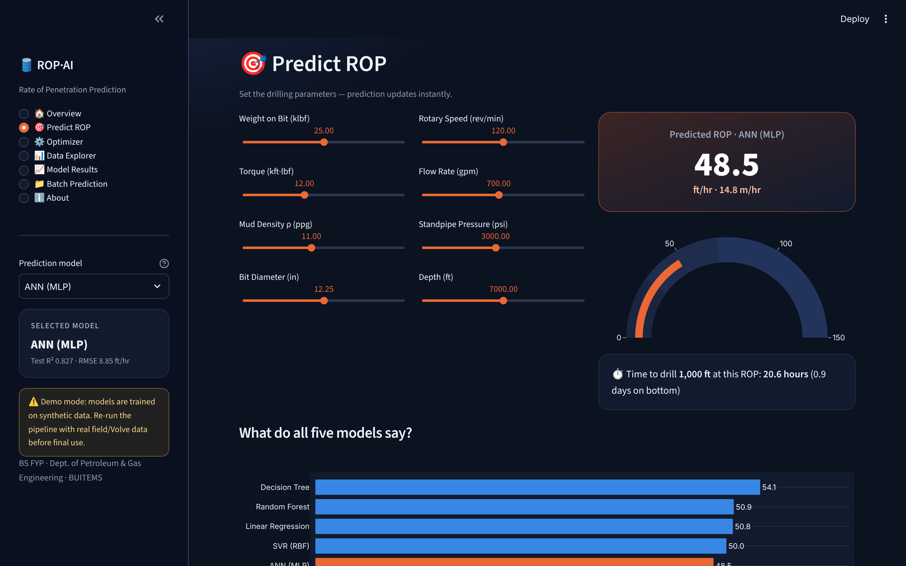

# Prediction of Rate of Penetration (ROP) Using Machine Learning

BS Final Year Project, Department of Petroleum & Gas Engineering, BUITEMS.

The project predicts drilling ROP (ft/hr) from WOB, RPM, torque, flow rate (Q), mud density (ρ), SPP, bit diameter and depth.
It compares five models: Linear Regression, Decision Tree, Random Forest, SVR and ANN.

## 🛢️ ROP·AI web app
```bash
pip install -r requirements.txt
streamlit run app/streamlit_app.py      # opens http://localhost:8501
```
Pages: Overview · Predict ROP (live sliders) · Optimizer (best WOB × RPM) · Data Explorer · Model Results · Batch Prediction (CSV) · About.
Full guide: `docs/ROP_AI_App_User_Guide.docx`. Screenshots: `docs/screenshots/`.



## Folder structure
| Path | Content |
|---|---|
| `code/generate_synthetic_data.py` | Synthetic **demo** dataset (for testing the code only, not real data) |
| `code/rop_pipeline.py` | Full workflow: cleaning → EDA → feature selection → 5 models + GridSearchCV → metrics → plots → saved model |
| `code/make_diagrams.py` | Flowchart, drilling system, ANN, random forest, CV and Gantt diagrams |
| `code/export_doc_data.py` | Collects results into `results/doc_data.json` for the thesis builder |
| `app/streamlit_app.py` | ROP·AI web app (Streamlit + Plotly) |
| `docs/ROP_AI_App_User_Guide.docx` | App user guide & technical documentation |
| `docs/build_thesis.js` | Builds the Word documents (BUITEMS format) |
| `docs/ROP_FYP_Proposal_Ch1-3.docx` | Proposal: Chapters 1–3 + work plan |
| `docs/ROP_FYP_Complete_Thesis_Draft.docx` | Complete thesis draft: Chapters 1–5 |
| `figures/`, `results/`, `models/`, `data/` | Generated outputs |

## How to run
```bash
pip install -r requirements.txt
python code/generate_synthetic_data.py          # only for demo data
python code/rop_pipeline.py                     # or: --data data/your_real_data.csv
python code/make_diagrams.py
python code/export_doc_data.py
node docs/build_thesis.js                       # needs: npm install docx
```
Your real CSV must have these columns: `Depth, WOB, RPM, Torque, Q, MW, SPP, Bit_Dia, ROP` (units: ft, klbf, rev/min, kft·lbf, gpm, ppg, psi, in, ft/hr).

> ⚠️ The current results in Chapter 4 come from **synthetic demo data**. Replace them with results from the real dataset (e.g. Equinor Volve) before submission.
